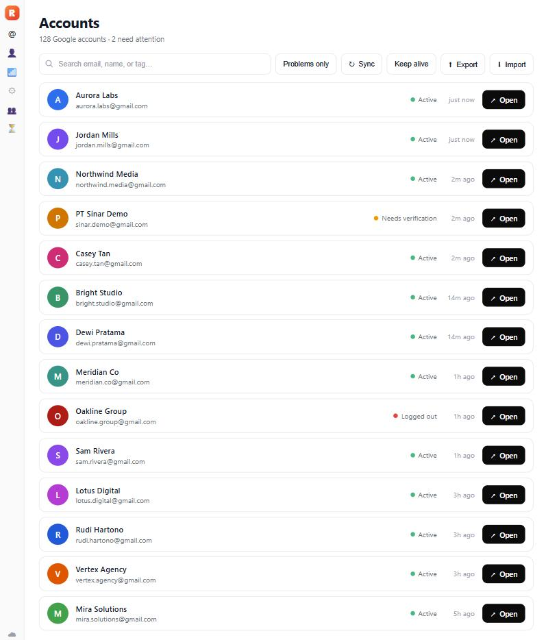

<div align="center">
  
  <h1>Roster Browser</h1>
  <p><strong>Manage hundreds of Google accounts by account, not by profile.</strong></p>
  <p><em>Kelola ratusan akun Google per akun, bukan per profil.</em></p>
</div>

<div align="center">
  
  <p><sub>Demo data — real accounts are not shown. · Data contoh — bukan akun asli.</sub></p>
  <p>
    <a href="https://github.com/mochalvi/roster-browser/releases/latest"><strong>⬇️ Download for Windows</strong></a>
  </p>
</div>

---

> **English below · [Bahasa Indonesia di bawah](#bahasa-indonesia)**

## English

### Why Roster

Managing many Google accounts in anti-detect browsers is slow: you open a
profile, wait for it to load, then check which account is inside — one profile at
a time. Roster flips this around. It lists your **accounts** directly as cards.
Click an account and it opens straight into Google signed in as that account. No
hunting through profiles first.

Under the hood Roster still uses browser profiles (it is a fork of
[Donut Browser](https://github.com/zhom/donutbrowser)), but it treats a profile
as a *slot holder*: Google allows up to 10 accounts signed in at once per
browser, so each profile holds up to 10 accounts and Roster opens a new hidden
profile when the slots fill. You see accounts; the profiles stay out of your way.

### Features

- **Account-first dashboard** — every Google account as a searchable card with
  avatar, status, tags, and last-refresh time.
- **One-click open** — opens `google.com` already signed in as the chosen
  account (via `authuser`).
- **Hidden profile slots** — up to 10 accounts per profile, auto-allocated, with
  an option to group related accounts into the same profile.
- **Sync / refresh** — keeps sessions warm in the background and shows a live
  per-account result (⏳ queued → 🔄 running → ✅ done · ⚠️ needs verification ·
  ❌ logged out).
- **Per-profile proxy & consistent fingerprint** — inherited from Donut's
  anti-detect engine; each account keeps a stable proxy, timezone, and
  fingerprint.
- **Import from an existing browser** — pull Google accounts you are already
  signed into in Chrome, Edge, or Firefox (see the honesty note below).
- **Encrypted export / import (`.roster`)** — copy your accounts and their
  sessions to another computer as one password-protected file (AES-256-GCM,
  Argon2id key derivation). The password is verified and the file decrypted
  whole *before* anything is written, so a wrong password changes nothing.
  Import is additive — it brings accounts in alongside what is already there.

### Keeping sessions alive — what actually works

There is no trick that guarantees a Google session survives forever; Google can
ask for verification at any time. What Roster does to maximise session lifetime:

- **After moving, stop using the account on the old machine.** The same session
  running in two places is the number-one cause of forced logout. Export copies
  rather than locks, so this discipline is on you until an opt-in "move" mode
  lands.
- **The proxy travels with the account** inside the profile, so the account
  keeps the same exit IP after import.
- **Fingerprint and timezone stay constant** per account.
- **Sessions are portable by design.** Roster's engine (Wayfern) keeps each
  profile's cookie-encryption key *inside the profile folder*, not in the OS
  keychain, so an exported session can still be decrypted on another machine.

When an account still lands on ⚠️, the safe fallback is a manual re-login in the
same profile — because the proxy and fingerprint are identical, Google usually
does not challenge it hard.

### Import from Chrome / Edge / Firefox — honesty note

| Source | Result |
|---|---|
| Firefox | Reliable — cookies.sqlite is not device-bound, so sessions move cleanly. |
| Chrome / Edge | Best-effort — recent Chrome binds data to the device (App-Bound Encryption), so some accounts will still ask for a re-login. |

After importing an account, **do not keep using it in the original browser**. A
session active in two places looks suspicious to Google and can log out both.

### Status

This is an active fork in development. The account layer, launcher, refresh, and
export/import are being built on top of Donut's profile engine.

### Download

A pre-built Windows installer (`.exe`) is on the
**[Releases page](https://github.com/mochalvi/roster-browser/releases/latest)** —
download `Roster_<version>_x64-setup.exe`, run it, and launch Roster.

> Windows SmartScreen may warn because the build is not code-signed yet. Choose
> *More info → Run anyway*, or build it yourself (below).

### Build

Roster is a [Tauri](https://tauri.app) app (Rust + Next.js). Requirements:

- Node.js 20+ and `pnpm`
- Rust (stable) and the platform C/C++ build tools

```bash
pnpm install
pnpm tauri dev      # run
pnpm tauri build    # package
```

### License

Roster Browser is licensed under the **GNU AGPL-3.0**, inherited from Donut
Browser. The full text is in [LICENSE](LICENSE). If you distribute a modified
version, including over a network, you must make your source available under the
same license.

Roster is a fork of **[Donut Browser](https://github.com/zhom/donutbrowser)** by
zhom. Credit for the profile, proxy, and anti-detect engine goes to the Donut
Browser project.

### Disclaimer

Roster Browser is a tool for managing **your own** Google accounts, or accounts
you are authorised to manage (for example a client's). You are responsible for
complying with Google's Terms of Service. Do not use it for mass account
creation, spam, fake engagement, or evading bans. The project ships no
account-creation automation and no CAPTCHA solving.

---

## Bahasa Indonesia

### Kenapa Roster

Mengelola banyak akun Google di anti-detect browser itu lambat: kamu buka
profil, tunggu loading, baru cek akun di dalamnya — satu profil satu per satu.
Roster membalik alur ini. Roster menampilkan **akun** langsung sebagai kartu.
Klik sebuah akun, browser langsung terbuka dalam keadaan login sebagai akun itu.
Tidak perlu buka-buka profil dulu.

Di belakang layar Roster tetap memakai profil browser (ini fork dari
[Donut Browser](https://github.com/zhom/donutbrowser)), tapi profil diperlakukan
sebagai *wadah slot*: Google mengizinkan maksimal 10 akun login bersamaan di satu
browser, jadi tiap profil menampung hingga 10 akun dan Roster otomatis membuat
profil tersembunyi baru saat slotnya penuh. Yang kamu lihat akun; profilnya
disembunyikan.

### Fitur

- **Dashboard berbasis akun** — tiap akun Google jadi kartu yang bisa dicari,
  lengkap dengan avatar, status, tag, dan waktu refresh terakhir.
- **Buka sekali klik** — langsung membuka `google.com` dalam keadaan login
  sebagai akun yang dipilih (lewat `authuser`).
- **Slot profil tersembunyi** — hingga 10 akun per profil, dialokasikan otomatis,
  dengan opsi mengelompokkan akun terkait ke profil yang sama.
- **Sync / refresh** — menjaga sesi tetap hidup di background dan menampilkan
  hasil per akun secara langsung (⏳ antri → 🔄 proses → ✅ selesai ·
  ⚠️ perlu verifikasi · ❌ logout).
- **Proxy per profil & fingerprint konsisten** — diwarisi dari mesin anti-detect
  Donut; tiap akun punya proxy, timezone, dan fingerprint yang tetap.
- **Import dari browser yang sudah ada** — ambil akun Google yang sudah login di
  Chrome, Edge, atau Firefox (lihat catatan kejujuran di bawah).
- **Export / import terenkripsi (`.roster`)** — salin akun dan sesinya ke
  komputer lain sebagai satu file berpassword (AES-256-GCM, derivasi kunci
  Argon2id). Password diverifikasi dan file didekripsi utuh *sebelum* ada yang
  ditulis, jadi password salah tidak mengubah apa pun. Import bersifat aditif —
  membawa akun masuk berdampingan dengan yang sudah ada.

### Menjaga sesi tetap hidup — yang benar-benar berpengaruh

Tidak ada trik yang menjamin sesi Google awet selamanya; Google bisa meminta
verifikasi kapan pun. Yang Roster lakukan untuk memperpanjang umur sesi:

- **Setelah pindah, berhenti memakai akun itu di komputer lama.** Sesi yang sama
  jalan di dua tempat adalah penyebab utama logout paksa. Export menyalin, bukan
  mengunci, jadi disiplin ini ada di tanganmu sampai mode "pindah" opsional
  tersedia.
- **Proxy ikut bersama akun** di dalam profil, jadi akun tetap memakai IP keluar
  yang sama setelah import.
- **Fingerprint dan timezone tetap** untuk tiap akun.
- **Akun di-refresh tepat sebelum export** supaya sesi yang dipindah masih baru.
- **Sesi memang dirancang portabel.** Engine Roster (Wayfern) menyimpan kunci
  enkripsi cookie tiap profil *di dalam folder profilnya*, bukan di keychain OS,
  sehingga sesi yang diekspor tetap bisa dibuka di komputer lain.

Kalau sebuah akun tetap berakhir ⚠️, jalan amannya adalah login ulang manual di
profil yang sama — karena proxy dan fingerprint-nya identik, Google biasanya
tidak meminta verifikasi berat.

### Import dari Chrome / Edge / Firefox — catatan kejujuran

| Sumber | Hasil |
|---|---|
| Firefox | Andal — cookies.sqlite tidak terikat perangkat, jadi sesi pindah mulus. |
| Chrome / Edge | Best-effort — Chrome versi baru mengikat data ke perangkat (App-Bound Encryption), jadi sebagian akun tetap akan minta login ulang. |

Setelah mengimpor sebuah akun, **jangan lagi memakainya di browser asalnya**.
Sesi yang aktif di dua tempat terlihat mencurigakan bagi Google dan bisa membuat
keduanya logout.

### Status

Ini fork yang sedang aktif dikembangkan. Lapisan akun, launcher, refresh, dan
export/import sedang dibangun di atas mesin profil Donut.

### Unduh

Installer Windows (`.exe`) siap pakai ada di
**[halaman Releases](https://github.com/mochalvi/roster-browser/releases/latest)** —
unduh `Roster_<versi>_x64-setup.exe`, jalankan, lalu buka Roster.

> Windows SmartScreen mungkin memberi peringatan karena build-nya belum
> ditandatangani (code-signing). Pilih *More info → Run anyway*, atau build
> sendiri (di bawah).

### Build

Roster adalah aplikasi [Tauri](https://tauri.app) (Rust + Next.js). Kebutuhan:

- Node.js 20+ dan `pnpm`
- Rust (stable) dan build tools C/C++ sesuai platform

```bash
pnpm install
pnpm tauri dev      # jalankan
pnpm tauri build    # paket rilis
```

### Lisensi

Roster Browser berlisensi **GNU AGPL-3.0**, diwarisi dari Donut Browser. Teks
lengkapnya ada di [LICENSE](LICENSE). Jika kamu mendistribusikan versi yang sudah
dimodifikasi, termasuk lewat jaringan, kamu wajib menyediakan source code-nya
dengan lisensi yang sama.

Roster adalah fork dari **[Donut Browser](https://github.com/zhom/donutbrowser)**
oleh zhom. Kredit untuk mesin profil, proxy, dan anti-detect ada pada proyek
Donut Browser.

### Penafian

Roster Browser adalah alat untuk mengelola akun Google **milikmu sendiri**, atau
akun yang kamu diberi wewenang mengelolanya (misalnya milik klien). Kamu
bertanggung jawab mematuhi Ketentuan Layanan Google. Jangan gunakan untuk
pembuatan akun massal, spam, engagement palsu, atau mengakali banned. Proyek ini
tidak menyertakan otomasi pembuatan akun maupun pemecah CAPTCHA.
